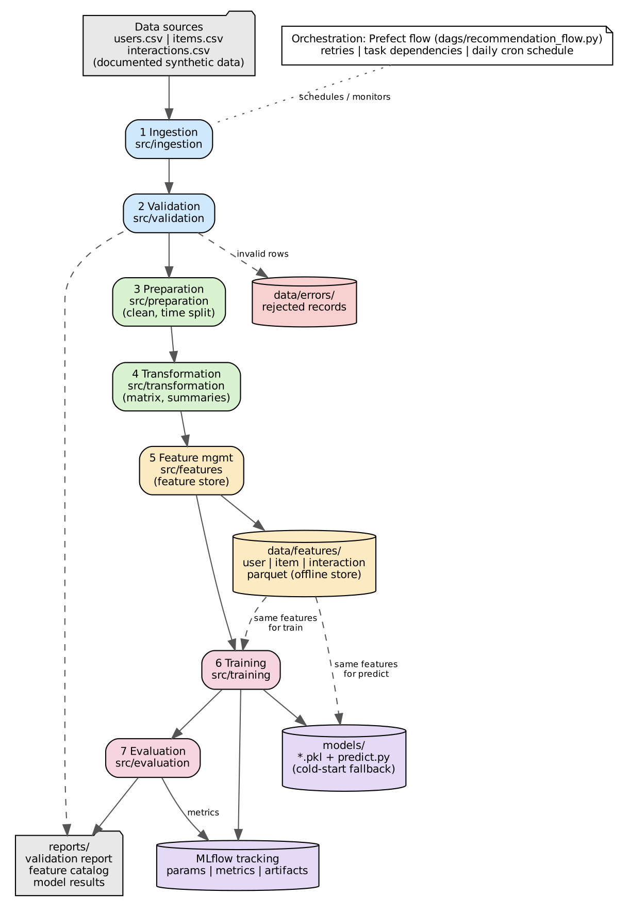

# End-to-End Data Management Pipeline for a Recommendation System

Data Management for Machine Learning - Assignment 2

An automated, reproducible pipeline for an e-commerce style recommender:

```
Ingestion -> Validation -> Preparation -> Transformation -> Feature Management -> Training -> Evaluation
                       (all orchestrated by a Prefect flow with task dependencies, retries and a cron schedule)
```



## Dataset
Documented **synthetic data** (generated by `src/ingestion/generate_data.py`, seed in `configs/config.yaml`):
2,000 users, 500 items (10 categories), ~52k rating interactions (1-5) with timestamps from 2023-2024.
Users prefer certain categories and items follow a popularity skew, so personalisation is learnable.
About 3% of records are **deliberately corrupted** (missing values, duplicates, wrong types, invalid ratings,
bad/future timestamps, orphan IDs, inconsistent casing) so the validation stage has real problems to catch.
You can replace `data/raw/{users,items,interactions}.csv` with your own CSVs (e.g. converted MovieLens) -
same column names - and the pipeline will use them instead of generating data.

## Setup
Python 3.10+ (tested on 3.12). Graphviz binary is only needed to regenerate the architecture diagram.

```bash
python -m venv .venv && source .venv/bin/activate      # Windows: .venv\Scripts\activate
pip install -r requirements.txt
```

## Run the whole pipeline (one command)
```bash
python run_pipeline.py            # or: python dags/recommendation_flow.py
```
Takes ~25 s. Outputs appear in `data/`, `models/`, `reports/`. Re-running gives identical results (seeded).
Force new synthetic data by deleting `data/raw/*.csv`.

Other entry points:
```bash
python dags/recommendation_flow.py --serve     # run as a daily scheduled deployment (cron 0 2 * * *)
python -m src.ingestion.ingest                 # any stage can be run alone, in order:
python -m src.validation.validate              #   ingest -> validate -> prepare -> transform
python -m src.preparation.prepare              #   -> features.feature_store -> training.train -> evaluation.evaluate
python -m src.transformation.transform
python -m src.features.feature_store
python -m src.training.train
python -m src.evaluation.evaluate
python -m src.training.predict --user U0001 --k 10   # top-10 for a user (cold-start users fall back to popularity)
pytest -q                                              # unit tests (metrics, split, validation)
mlflow ui --backend-store-uri sqlite:///mlflow.db      # browse runs: params, metrics, model artifacts
```

## Project structure
```
data/raw          raw CSVs + ingestion_manifest.json (row counts, md5)
data/processed    validated/, cleaned tables, train/test, sparse matrices, user activity summary, item popularity
data/features     user_features / item_features / interaction_features (parquet = offline feature store)
data/errors       rejected records per table with error reasons
src/ingestion, validation, preparation, transformation, features, training, evaluation
dags/             Prefect flow (recommendation_flow.py)
configs/          config.yaml (all parameters)
models/           trained models (.pkl) + MLflow run ids
reports/          validation report, feature catalog, model results, diagrams, run log
tests/            pytest unit tests
```

## Pipeline stages
| Stage | Module | What it does |
|---|---|---|
| Ingestion | `src/ingestion` | Reads/generates user, item, interaction CSVs; writes a manifest (rows, md5) |
| Validation | `src/validation` | 23 rule checks (missing, duplicates, types, rating range, timestamps, referential integrity); `reject` rows -> `data/errors/`, `warn` rows repaired later; report in `reports/data_validation_report.md` |
| Preparation | `src/preparation` | Type casting, format standardisation, imputation, de-duplication, **time-based split** (latest 20% = test) with a leakage assertion |
| Transformation | `src/transformation` | ID mappings, sparse user-item matrices, user activity summary, item popularity (train only) |
| Features | `src/features` | Documented feature registry -> catalog; same code for training and prediction; parquet store with lookup API |
| Training | `src/training` | Popularity baseline, item-kNN CF, SVD matrix factorisation (+ biased MF for ratings); MLflow tracking |
| Evaluation | `src/evaluation` | Precision/Recall/NDCG@K, Coverage, Diversity, RMSE/MAE; results table |
| Orchestration | `dags/` | Prefect flow, 8 tasks, ordered dependencies, 1 retry, cron schedule |

## Results (K = 10, time-based hold-out)
See `reports/model_results.md` for the full tables (K = 5 and K = 10).

## Deliverable checklist
- Source code in modules ........ `src/`
- README / requirements ......... this file, `requirements.txt`
- Architecture diagram .......... `reports/architecture_diagram.png`
- Validation report/logs ........ `reports/data_validation_report.md|json`, `data/errors/`
- Feature catalog ............... `reports/feature_catalog.md|csv`
- Model evaluation results ...... `reports/model_results.md|csv`
- Orchestration workflow ........ `dags/recommendation_flow.py`; run evidence `reports/orchestration_run.png`, `reports/pipeline_run.log`

## Limitations
Synthetic data (results are not comparable to real-world benchmarks); no online/streaming ingestion; single global
time split; cold-start users/items are excluded from offline evaluation and handled only by a popularity fallback;
diversity is category-based; Prefect runs locally (no distributed workers).
